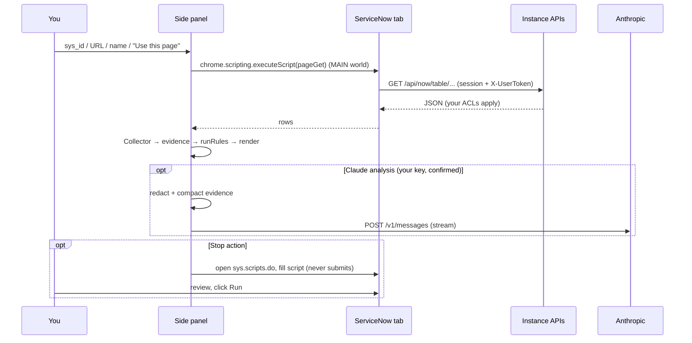

# Architecture

A Manifest V3 extension with no build step and no dependencies. Everything is plain ES modules loaded by the side panel.

## Layout

| Path | Role |
| --- | --- |
| `manifest.json` | Permissions: `sidePanel`, `scripting`, `storage`, `tabs`; hosts `*.service-now.com`, `*.servicenowservices.com`, `api.anthropic.com`; optional hosts for custom domains |
| `background.js` | Opens the side panel when the toolbar icon is clicked |
| `sidepanel.html` / `.css` / `.js` | The UI: input, cards, settings, exports, Claude card, stop actions card |
| `lib/sn-client.js` | Read-only REST client. `pageGet` is injected into the ServiceNow tab (MAIN world) and issues same-origin `GET`s with the session and `g_ck` token; an allowlist rejects anything but `/api/now/table/*` and `/api/now/stats/*` |
| `lib/schema.js` | Dictionary discovery: table hierarchy (`sys_db_object`), fields and references (`sys_dictionary`), reverse references, field-name heuristics |
| `lib/config.js` | Candidate table names, resolve order, heuristics, default settings |
| `lib/collectors.js` | `Collector.trace()`: resolves an input to a record, then collects plan, children, agents, tools, dependencies, ACLs, run-as roles, conversation, time-window logs and plugins into one evidence object with normalised views (`ev.norm`) |
| `lib/timeline.js` | Builds the ordered conversation timeline and extracts readable text from Virtual Agent payloads |
| `lib/rules.js` | `runRules(ev)`: 45 deterministic rules, severity sort and root-cause ranking |
| `lib/redact.js` | PII masking and body omission for exports and Claude |
| `lib/report.js` | Markdown report |
| `lib/claude.js` | Optional Claude analysis: compact evidence, system prompt, streaming Messages API client, follow-up session, safe Markdown rendering |
| `lib/actions.js` | Optional stop scripts (ES5 background-script generators) and the function that fills `sys.scripts.do` |
| `test/` | Mock ServiceNow instance, mock Messages API, in-memory Glide runtime, Node tests, Chromium end-to-end test |

## Data flow

## Discovery instead of hard-coded fields

The collector asks the instance which tables reference the record being traced (`sys_dictionary` where `internal_type=reference` and `reference` is in the table's hierarchy), limited to AI-related prefixes (`sn_aia`, `sys_gen`, `sys_generative`, `sn_nowassist`, `sys_one_extend`, `sys_cs_`). That is how it finds execution tasks, messages, tool executions and conversation messages without knowing their field names. Semantic fields (state, error, input, output, name…) are matched by name patterns in `lib/config.js`. If the dictionary is not readable, it falls back to documented names and raises the `DICT` finding.

## Table names

Documented in ServiceNow product documentation (Australia release): `sn_aia_execution_plan`, `sn_aia_execution_task`, `sn_aia_message`, `sn_aia_agent`, `sn_aia_agent_tool_m2m`, `sn_aia_team_member`, `sn_aia_trigger_configuration`, `sn_aia_memory`, `sys_generative_ai_config`, `sys_generative_ai_log`, `sys_gen_ai_usage_log`, `sys_gen_ai_log_metadata`, `sys_one_extend_capability`, `sys_cs_conversation`.

Added from the Brazil upgrade notes: `sys_generative_ai_prompt_config`, `sn_aia_property` (agent properties), `sn_aia_external_agent_configuration` (external agents). The collector also reads `sys_properties` for the release (`glide.buildtag.last`, `glide.buildtag`, `glide.buildname`, `glide.war`), the Kill Switch properties (`*kill_switch*`) and `mcp_guardian_check`, and all `sys_security_acl` rows of the agentic AI types.

Best guesses, probed on every trace and skipped if absent: `sn_aia_usecase`, `sn_aia_tool`, `sn_aia_tools_execution` / `sn_aia_tool_execution`, `sn_nowassist_skill_config`, `sys_cs_message`, `sys_outbound_http_log`, `sys_flow_context`, `sys_restricted_caller_access`. Edit `TABLES` in `lib/config.js` if your release differs, and please open an issue with what you found.

## Tests

| File | Covers |
| --- | --- |
| `test/collect-and-rules.test.mjs` | URL parsing, allowlist, plan/agent/skill/workflow/conversation traces, rules, root-cause ranking, timeline, redaction, report |
| `test/claude.test.mjs` | Compact evidence, redaction before send, prompt-injection wrapping, streaming client, headers, errors, follow-up history |
| `test/actions.test.mjs` | Stop scripts executed against an in-memory Glide runtime: dry run, apply, instance lock, age check, cap, no-choice skip, flow opt-in, deactivate, script-injection safety |
| `test/e2e.mjs` | Loads the unpacked extension in Chromium, maps `mock.service-now.com` to the mock instance, runs traces, Claude analysis and the Scripts - Background fill (verifies it is never submitted) |

The mock instance (`test/mock-instance.mjs`) uses fictional records. Its field names are test fixtures, not claims about the product.
