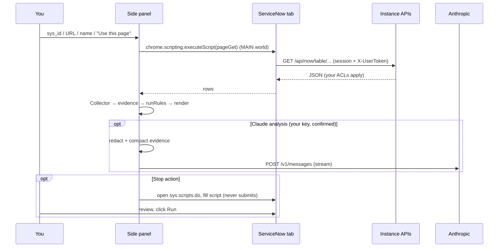

# Architecture

A Manifest V3 extension with no build step and no dependencies. Everything is plain ES modules loaded by the side panel.

## Layout

| Path | Role |
| --- | --- |
| `manifest.json` | Permissions: `sidePanel`, `scripting`, `storage`, `tabs`, `contextMenus`; commands `_execute_action` (Alt+Shift+O) and `trace-page` (Alt+Shift+U), chosen outside Chrome's own shortcuts on every desktop platform (Chrome won't assign those to an extension); hosts `*.service-now.com`, `*.servicenowservices.com`, `api.anthropic.com`; optional hosts for custom domains |
| `background.js` | Opens the side panel from the toolbar icon, the right-click menu on ServiceNow pages and the `trace-page` shortcut; leaves the request (page URL, frame URL, link or selected text) in `chrome.storage.session` for the panel to pick up |
| `sidepanel.html` / `.css` / `.js` | The UI: input, cards, settings, exports, Claude card, stop actions card |
| `lib/sn-client.js` | Read-only REST client. `pageGet` is injected into the ServiceNow tab (MAIN world) and issues same-origin `GET`s with the session and `g_ck` token; an allowlist rejects anything but `/api/now/table/*` and `/api/now/stats/*` |
| `lib/schema.js` | Dictionary discovery: table hierarchy (`sys_db_object`), fields and references (`sys_dictionary`), reverse references, field-name heuristics |
| `lib/config.js` | Candidate table names, resolve order, heuristics, default settings |
| `lib/collectors.js` | `Collector.trace()`: resolves an input to a record, then collects plan, children, agents, tools, dependencies, ACLs, run-as roles, conversation, time-window logs and plugins into one evidence object with normalised views (`ev.norm`) |
| `lib/logs.js` | The run's log lines at every level (`runLogs`), level groups, filters, plain-text copy, and links into the instance: System Log list with the trace's filter, flow executions in Flow Designer |
| `lib/timeline.js` | Builds the ordered conversation timeline and extracts readable text from Virtual Agent payloads |
| `lib/rules.js` | `runRules(ev)`: 53 deterministic rules, severity sort and root-cause ranking |
| `lib/redact.js` | PII masking and body omission for exports and Claude |
| `lib/report.js` | Markdown report |
| `lib/claude.js` | Optional Claude analysis: compact evidence, system prompt, streaming Messages API client, follow-up session, safe Markdown rendering |
| `lib/actions.js` | Optional stop scripts (ES5 background-script generators) and the function that fills `sys.scripts.do` |
| `test/` | Mock ServiceNow instance, mock Messages API, in-memory Glide runtime, Node tests, Chromium end-to-end test |

## Data flow

## Discovery instead of hard-coded fields

The collector asks the instance which tables reference the record being traced (`sys_dictionary` where `internal_type=reference` and `reference` is in the table's hierarchy), limited to AI-related prefixes (`sn_aia`, `sys_gen`, `sys_generative`, `sn_nowassist`, `sys_one_extend`, `sys_cs_`). That is how it finds execution tasks, messages, tool executions and conversation messages without knowing their field names. Semantic fields (state, error, input, output, name…) are matched by name patterns in `lib/config.js`. If the dictionary is not readable, it falls back to documented names and raises the `DICT` finding.

## Table names

Documented in ServiceNow product documentation (Australia release): `sn_aia_execution_plan`, `sn_aia_execution_task`, `sn_aia_message`, `sn_aia_agent`, `sn_aia_agent_tool_m2m`, `sn_aia_team_member`, `sn_aia_trigger_configuration`, `sn_aia_memory`, `sys_generative_ai_config`, `sys_generative_ai_log`, `sys_gen_ai_usage_log`, `sys_gen_ai_log_metadata`, `sys_one_extend_capability`, `sys_cs_conversation`.

Added from the Brazil upgrade notes: `sys_generative_ai_prompt_config`, `sn_aia_property` (agent properties), `sn_aia_external_agent_configuration` (external agents). The collector also reads `sys_properties` for the release (`glide.buildtag.last`, `glide.buildtag`, `glide.buildname`, `glide.war`), the Kill Switch properties (`*kill_switch*`) and `mcp_guardian_check`, and all `sys_security_acl` rows of the agentic AI types.

**Skill table.** The collector reads it from the Generative AI log's skill reference field (Skill Config Id) in `sys_dictionary`, so it follows the instance's release. `sn_nowassist_skill_config` is only the fallback when the dictionary is not readable.

Not in the documentation but present on a live Australia patch 7 instance, and still probed on every trace and skipped if absent: `sn_aia_usecase`, `sn_aia_tool`, `sn_aia_tools_execution` / `sn_aia_tool_execution`, `sn_nowassist_skill_config` (fallback, see above), `sys_cs_message`, `sys_outbound_http_log`, `sys_flow_context`, `sys_restricted_caller_access`. Edit `TABLES` in `lib/config.js` if your release differs, and please open an issue with what you found.

## Live-instance facts the code relies on

Read from a live Australia patch 7 instance; the mock instance reproduces each one.

- The Table API returns `sys_dictionary.internal_type` and `.reference` as `{ link, value }` unless `sysparm_exclude_reference_link=true`. The schema reader sets the flag and unwraps either shape.
- `window.NOW.user` in Next Experience holds only `userID` and `isImpersonating`; the user name is read from `sys_user`.
- Plan states: `ready`, `queued`, `in_progress`, `awaiting_input`, `wrap_up`, `completed`, `terminated`, `abandoned`, `deleted`. `state_reason`: `planning_failed`, `execution_failed`, `security_violation` (failures) and `user_exited`, `no_activity`, `live_agent_requested`, `fallback_redirected` (not). `awaiting_input` is a chat waiting on the user, not a stuck run.
- Tasks point at their agent or workflow with `target_document_table` + `target_document_id`, not a reference; plans name their business record with `related_task_table` + `related_task_record`.
- Workflow teams: `sn_aia_usecase.team` → `sn_aia_team` ← `sn_aia_team_member.team`. A team can be shared by workflows, so plan traces do not pull in the whole team.
- The Gen AI log's `prompt` is a JSON messages array (`[{"role":"user","content":"…"}]`) with escaped newlines, so the grounding checks unwrap it before reading lines (`promptText`).
- Skill calls name the record they ran on in the Gen AI log's `metadata_table` + `metadata_document` (for example `sn_em_evidence`); `source` tells the action (`WWNA: Default` for Summarize, `WWNA: Refine`). A wrapper skill's inner skill call is logged with no record, so record and Gen AI log traces add calls by the same user within ±5 s (on the live instance, wrapper and inner call were logged in the same second). Workspace URLs nest records (`…/record/<case>/<id>/…/sub/record/<evidence>/<id>`); the last one is on screen.
- `syslog` rows carry `context_map` (JSON) with `_user`, `_logged_in_user`, `_scope`, `_txid`, `record_sys_id`, `table_name` and `_script_record`. A user's session writes its user name to both `sys_created_by` and `_user`; background jobs write `system`. In one 4-minute window there were 500+ errors and warnings, all from other jobs. `annotateLinks` (rules.js) marks a line as the run's when it names a record of the run or comes from a run user's session; the collector also queries those lines directly, so the 200-row window sample cannot push them out. The asynchronous half of a skill call (GenAI preprocess, request validators, the Flow Designer callback) logs with `_user` = `system` but the caller in `sys_created_by`, so either field counts: on one skill call that was 6 of 37 lines.
- `syslog.level` choices: `-2` Trace, `-1` Debug, `0` Information, `1` Warning, `2` Error, `3` Fatal. The instance logged about 12 info lines a second, so the run's warnings and errors (`levelIN1,2,3`) and its info and debug lines (`levelNOT IN1,2,3`, first 150) are separate queries, run in parallel with the window sample.
- `$flow-designer.do#/operations/context/<id>` redirects to Workflow Studio's flow execution view (`/now/workflow-studio/builder?tableName=sys_flow_context&builderId=flow-execution`) on releases that have it.
- Gen AI log status values: `success`, `error`, `failed`. Some `error` rows carry the message "Success" with code `200000`. `output_metadata` holds timings only (no finish reason), so truncation is judged by tokens: `prompt_config_id` → `sys_generative_ai_prompt_config.ai_config` → `sys_generative_ai_config.max_tokens`.
- Big tables: an unfiltered one-row probe of `syslog` took 8 s and a full fetch of 100 flow contexts 6.6 s. Probes are primary-key lookups, every list skips the row count (`sysparm_no_count`), and window queries ask only for the columns the rules read.

## Tests

| File | Covers |
| --- | --- |
| `test/collect-and-rules.test.mjs` | URL parsing, allowlist, plan/agent/skill/workflow/conversation traces, rules, root-cause ranking, timeline, redaction, report |
| `test/claude.test.mjs` | Compact evidence, redaction before send, prompt-injection wrapping, streaming client, headers, errors, follow-up history |
| `test/skills.test.mjs` | Skill table from the dictionary, unfilled prompt variables, truncation and the token-limit chain, flow quick mode, `sn-gaf` errors, Recent failures, evidence links; terminated plans and state_reason, PLAN-SECURITY, document-ID links, workflow → team → member, window-noise filters, user name from sys_user, `{ link, value }` dictionary rows. `findEmptyGrounding`, including shapes from real prompts (section headers, output templates, JSON messages) |
| `test/logs.test.mjs` | Run logs at every level from the mock's info and debug lines, level names (Fatal is an error), filters, plain-text copy, report and Claude payload, System Log list link, Flow Designer link, the `sys_created_by`/`_user` link rule |
| `test/manifest.test.mjs` | Suggested shortcuts avoid Chrome's own Alt+Shift keys (`accelerator_table.cc`) on Windows and Linux; the docs name the manifest's keys |
| `test/actions.test.mjs` | Stop scripts executed against an in-memory Glide runtime: dry run, apply, instance lock, age check, cap, no-choice skip, flow opt-in, deactivate, script-injection safety |
| `test/e2e.mjs` | Loads the unpacked extension in Chromium, maps `mock.service-now.com` to the mock instance, runs traces, Claude analysis and the Scripts - Background fill (verifies it is never submitted) |

The mock instance (`test/mock-instance.mjs`) uses fictional records. Its field names are test fixtures, not claims about the product.
